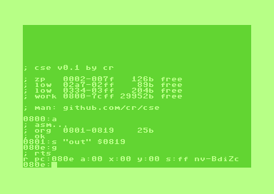
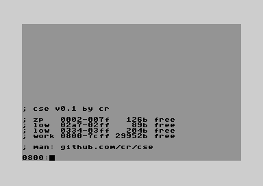
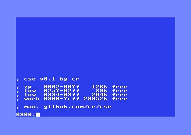
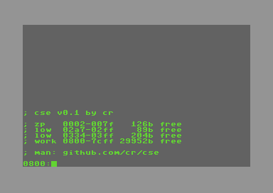
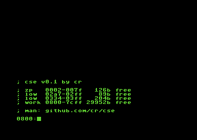
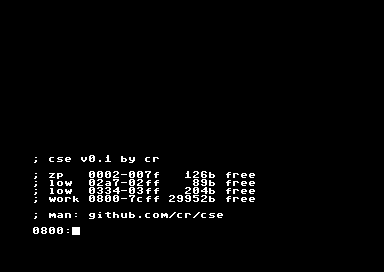
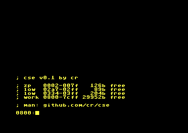
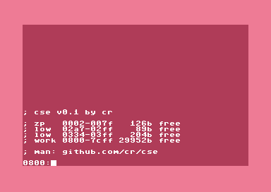
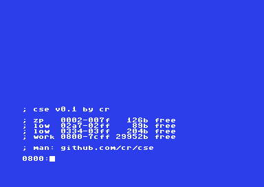
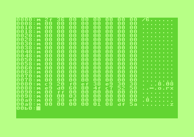

# CSE — THE INTEGRATED C64 ASM ENV

CSE is a native, integrated assembler and debugger environment for the
Commodore 64 — editor, assembler, disassembler, hex monitor, expression
calculator, and step debugger sharing one screen and one command grammar.
Its workflows are inspired by MasterSeka, radare2, and SMON. Edit,
assemble, run, and debug in one place, natively on the C64 itself.
Pure and simple.

  

## Who it's for

CSE is built for two kinds of programmer, and it refuses to compromise
on either.

**Experienced developer** who want a sketchpad. An immediate-mode
6502 REPL with no toolchain, no build step, no context switch back to
the host OS. The loop from "I want to try something" to "I am watching
it run" feels fluent without some pipeline in the middle.

**The learners** who want a first computer that does one thing
honestly. 64 K of RAM you can read entirely, 56 well-documented CPU
instructions, a one-page memory map, a screen that is literally the
command buffer. No browser tabs, no notifications, no package
managers. The scope is finite, the ceiling is visible, and the
computer hides no complexity. Give them a 6502 book and the CSE
cheat sheet, and they're good to go.

The same design principles serve both — minimal footprint, maximum
workspace, fluent interaction, one environment instead of many tools —
because beginner and expert likewise benefit from a computer you can
understand completely.

For the longer story — why CSE exists, how it compares to its peers,
and what keeps the promise honest — see [background.md](background.md).

## Contents

- [Concepts](#concepts)
- [Quick start](#quick-start)
  - [Themes](#themes)
- [REPL commands](#repl-commands)
- [Error and warning messages](#error-and-warning-messages)
- [Editor](#editor)
- [Assembler syntax](#assembler-syntax)
- [Memory layout](#memory-layout)
- [Built-in symbols](#built-in-symbols)
- [On the MEGA65](#on-the-mega65)
- [Development](#development)
- [License](#license)

## Concepts

CSE has two modes: the **REPL** and the **editor**.  Press RUN/STOP
to switch between them.

The **REPL** is a command prompt for inspecting memory, assembling,
running, and debugging code.  Every command operates on the
*current address* shown in the `AAAA:` prompt.  Navigate with `@`,
`+`, `-`.

  

The **editor** is a full-screen text editor for writing assembly
source.  The `a` command in the REPL assembles the editor's content
into memory.

**Type in lowercase.**  CSE runs in the C64's lowercase character
set: commands, mnemonics, labels and hex digits are typed without
SHIFT (`lda $d020`).  SHIFTed letters are separate keys — `B`, `C`,
`Q` and `R` are commands of their own — and hex digits must be
lowercase: `$d020` is a number, `$D020` typed with SHIFT is an error.

### Your workspace

Your programs and data live in the **workspace**, from `$0800`
(`workstart`) up to the byte below your source text (`workend`).
CSE itself sits above it.  The assembler refuses to write outside
the workspace (`;?N: range`), and breakpoints must be inside it.
Type `i` to see where `workend` is right now; it moves down as your
source grows.  Every example address in this manual (`$1000`,
`$2000`) is a workspace address.

### The edit-assemble-run cycle

1. Write source in the editor (RUN/STOP to enter).
2. Switch back to the REPL (RUN/STOP).
3. Set the origin: `.org $1000` in the source, or `@ $1000` in the
   REPL before assembling (or `.bas` in the source for a program
   that starts with `RUN`).
4. Assemble: `a`
5. Run: `g` (jumps to the `main:` label).
6. Inspect: `d` to disassemble, `m` to hex-dump, `r` for registers.
7. Debug: `b ADDR` to set a breakpoint on an instruction of your
   program, `g` to run, `t` or `o` to step, `c` to continue.

Repeat.  The source stays in the editor buffer between runs.
Save the source with `s "proj"` — it stores the source as a SEQ file
with the project name.  Save the assembled binary with the save line
`a` prints, or any PRG-mode form (e.g. `s "proj" $1000 $10ff`) — it stores
as `proj.` (trailing dot) so source and binary never collide.

### Current address

The REPL prompt shows `AAAA:` — this is the *current address*.
It determines where `d`, `m`, `.`, `j`, `t` operate and is the
default origin for `a`.  Set it explicitly with `@ EXPR`, by typing
an `AAAA:` prefix in front of a command, or navigate with `+`/`-`.
`d`, `m` and `.` leave it after the bytes they showed.  After a
successful `a`, the current address moves to the `main:` label if
the source defines one; a break in your program moves it to the
break address.

### Block size

Commands like `d` (disassemble) and `m` (memory dump) operate on
a chunk of *block size* bytes.  Default is `$10` (16).  Change it
with `B EXPR`.  `+` and `-` also advance/retreat by the block size.

### Screen editing

`m` and `d` print rows that are themselves commands: an `m` row is
an `m` edit command, a `d` row a `.` command.  Move the cursor to
any row, edit the values directly on screen, and press RETURN to
execute the modified row.  This is the C64 screen-editor workflow:
the screen *is* your input buffer.

For example, `d` might show:

    1000:.  a9 42     lda #$42
    1002:.  8d 20 d0  sta $d020
    1005:.  60        rts

Cursor up to the first row, change `42` to `07`, press RETURN — the
byte at `$1001` is now patched and the row reads `lda #$07`.
Changing the mnemonic or operand instead re-assembles the
instruction.  Pressing RETURN on an empty prompt repeats the last
`d`, `m`, `.`, `t` or `o` — `d` RETURN RETURN pages on through the
code.

One limit: the REPL assembles the accumulator form only bare —
`. asl` works, `. asl a` is `;?syntax` — so RETURN on a `d` row that
shows `asl a` needs the `a` removed first.

### Expressions

Anywhere CSE expects a number — command arguments, assembler
operands, directive values — you can use a full expression with
arithmetic, labels, and lo/hi byte operators.  Bare digits are
decimal; hex needs a `$`.  See [Assembler syntax](#expressions-1)
for details.

## Quick start

### Get the binary

Grab the latest release from
[github.com/cr/cse/releases/latest](https://github.com/cr/cse/releases/latest).
Each release attaches:

| File | Use |
|------|-----|
| `cse.d64` | Disk image — mount in VICE or write to a real 1541; contains all three CPU variants |
| `cse-exo.prg` | 6510 build (default — exomizer-compressed, handles illegal opcodes) |
| `cse-6502-exo.prg` | 6502 build — strict legal opcodes only |
| `cse-cmos-exo.prg` | 65C02 build — adds CMOS opcode set |

Or [build from source](#development) if you prefer.

### Run

    LOAD "CSE",8,1
    RUN

CSE boots into the REPL. Type commands at the `AAAA:` prompt.
Press RUN/STOP to toggle between the REPL and the source editor.

### Themes

CSE ships with eighteen compile time colour themes — pick one
with `make THEME=NAME`, or change the colours with the `C` REPL
command.  CLOUDY is the default on the C64 and the MEGA65.

<table>
<tr>
  <td align="center"> CLOUDY <i>(default)</i></td>
  <td align="center"> CONCRETE</td>
  <td align="center"> ASPHALT</td>
  <td align="center"> JIFFY</td>
</tr>
<tr>
  <td align="center"> GREENLAND</td>
  <td align="center"> MOSS</td>
  <td align="center"> RADIOACTIVITY</td>
  <td align="center"> MATRIX</td>
</tr>
<tr>
  <td align="center"> HERCULES</td>
  <td align="center"> MILKYWAY</td>
  <td align="center"> BRUCELEE</td>
  <td align="center"> LEEBRUCE</td>
</tr>
<tr>
  <td align="center"> MRSPIGGY</td>
  <td align="center"> ORANGE</td>
  <td align="center"> MUDDY</td>
  <td align="center"> C64</td>
</tr>
<tr>
  <td align="center"> C128</td>
  <td align="center"> MEGA <i>(the MEGA65's own)</i></td>
  <td colspan="2" align="left" valign="top">Or specify any 3-digit hex code directly: <code>make THEME=cb5</code> (border, background, foreground — C64 palette <code>0</code>–<code>f</code>).  At runtime, <code>C bgf</code> (three adjacent hex digits, e.g. <code>C fc1</code>) sets all three.</td>
</tr>
</table>

## REPL commands

A command is one character, optionally after an `AAAA:` address
prefix (four hex digits and a colon, which set the current address
first), followed by its arguments.  `;` starts a comment.  `EXPR`
and `ADDR` are expressions ([Expressions](#expressions)); `HH` is two
hex digits.

### Navigation

| Command | Syntax | Description |
|---------|--------|-------------|
| `@` | `@ EXPR` | Set current address |
| `+` | `+ [EXPR]` | Advance by EXPR (default: block size) |
| `-` | `- [EXPR]` | Retreat by EXPR (default: block size) |
| `B` | `B [EXPR]` | Show or set block size (default `$10`); `B` is SHIFT+B |

### Inspect and edit memory

| Command | Syntax | Description |
|---------|--------|-------------|
| `.` | `.` | Disassemble one instruction at current address |
| `.` | `. HH [HH] [HH]` | Poke 1–3 hex bytes at current address |
| `.` | `. MNEM [OPERAND]` | Assemble one instruction at current address |
| `d` | `d` | Disassemble block-size bytes |
| `m` | `m [HHHH]` | Hex+character dump of block-size bytes (at `HHHH` if given) |
| `m` | `m HH [HH] ...` | Write up to 8 bytes at current address |
| `i` | `i` | Show full memory map |

`m` and `.` show and edit **your** zero page: `$00`–`$7f` as your
program sees it, not CSE's own values there.

  
  &nbsp;&nbsp;
  

### Assembler

| Command | Syntax | Description |
|---------|--------|-------------|
| `a` | `a` | Assemble the source in the editor; code before the first `.org` goes to the current address |
| `u` | `u [MODE]` | Show or set CPU mode: `6502` on every build, `6510` on the 6510 build, `65c02` on the 65C02 build |

`a` prints one `; org AAAA-BBBB NNb` row per block of code, then
`; ok` and a ready-made save line (`AAAA:s "proj" $bbbb` — cursor up
and RETURN saves the binary), or `; N err` after the error rows.
After a successful `a`, the current address moves to `main:` if the
source defines it, and `g` runs it.

### Run and debug

| Command | Syntax | Description |
|---------|--------|-------------|
| `j` | `j [ADDR]` | Run your code at ADDR (default: current address) |
| `g` | `g` | Run at label `main` (current address if there is no `main`) |
| `t` | `t [EXPR]` | Step into, EXPR instructions (default 1) |
| `o` | `o [EXPR]` | Step over — a `jsr` runs as one step (EXPR instructions, default 1) |
| `c` | `c` | Continue after a break |
| `b` | `b` | List breakpoints |
| `b` | `b ADDR` | Set breakpoint (8 slots; ADDR must be in the workspace) |
| `b` | `b -N` | Delete breakpoint N (1–8) |
| `b` | `b *` | Clear all breakpoints |
| `r` | `r` | Show registers (PC, A, X, Y, SP, flags) |
| `r` | `r a:HH x:HH ...` | Set registers |

Your program runs until it returns with `rts` (`; rts` and the
final registers), hits a breakpoint or a `brk` (`; brk at $PC`,
registers, and the next instruction), or you press
RUN/STOP+RESTORE (`; nmi at $PC`).  A break opens a **debug
session**: `t`, `o`, `c` and `r` work on the stopped program.

- `t` / `o` with no session show a **preview** (`; dbg at $PC`,
  registers, the instruction) of the code at the current address
  without running it; the next `t` / `o` / `c` starts it.
- Each step prints the instruction that ran, then the new break
  panel.  Pressing RETURN on an empty prompt takes another step.
- `c` right after a breakpoint stop deletes that breakpoint, then
  continues — set it again with `b` to keep stopping there.  `c`
  steps over a `brk` you put in your code.
- A step whose next instruction lies outside the workspace (a jump
  into ROM or into CSE) is refused with `;!range`; the session
  stays, `c` runs on.  Stepping into a `jsr` to the KERNAL ROM
  (`$e000`–`$ffff`) steps over it instead.
- After the program has returned (`; rts`) the session is over:
  `c`, `t` and `o` answer `;?no ctx`; run it again with `j` or `g`.

`r` fields go in any order and any subset: `a:HH` `x:HH` `y:HH`
`s:HH` `pc:HHHH` and the 8-character flags field `nv-bdizc`
(uppercase = set, lowercase or `-` = clear).  A bad field is
`;?syntax` and changes nothing.  Edit a shown `r` row on screen and
press RETURN to set it.

RUN/STOP+RESTORE breaks into the debugger while your code is
running.  Pressed at the REPL prompt or in the editor, it redraws the
REPL screen (classic C64 behaviour) and keeps any debug session.

  

**Ending a debug session.**  `a`, `j` and `g` need a clean session;
while one is stopped at a break they ask first (`;!debug`, then
`;!asm? y/n` or `;!go? y/n`); `y` ends the session and runs the
command.  `R` (reset) asks `;!init? y/n` and ends any session.

### Files

| Command | Syntax | Description |
|---------|--------|-------------|
| `l` | `l "proj"` / `l "proj" 0` / `l "proj" $2000` / `l "proj,p"` | Load source (SEQ) or binary (PRG); `0` uses the PRG's own load address |
| `s` | `s "proj"` / `s "proj" $end` / `s "proj" $start $end` | Save source (SEQ) or binary (PRG) |
| `$` | `$ [DEVICE]` | Directory listing; DEVICE (decimal 4–30) also becomes the current drive (default 8) |

CSE is source-centric: a **project name** is a stem like `demo` that
stands for both the source and the binary.  Disk filenames are derived:
source is `demo` (SEQ), binary is `demo.` (trailing dot, PRG).  They
can't collide in the CBM DOS directory.

- Bare `l "demo"` / `s "demo"` loads/saves the **source**.
- Any address argument forces **PRG** mode: `s "demo" $2000` saves the
  binary as `demo.`; `l "demo" $2000` loads the binary to `$2000`,
  `l "demo" 0` loads at the PRG header address.
- Explicit `,s` or `,p` suffix bypasses derivation: `s "foo,p"` saves
  as literal `foo` PRG; `l "foo,s"` loads literal `foo` SEQ.
- Bare `s` or `l` (no string) reuses the last project name (default `out`).

PRG save addresses: one arg is end (start = current address); two
args are start and end.  **End is inclusive** — `s "proj" $1000 $2000`
saves bytes `$1000..$2000` inclusive, i.e. `$1001` bytes.  If end ≤
start, the arg is treated as a length.  End = 0 saves one block size.

After a source load or save CSE prints `; Nl Mb` (lines, bytes) and
warns `;!long LNN` for each line wider than the editor's 39 columns.
Loading source over unsaved edits asks `;!load? y/n` first.

### Utility

| Command | Syntax | Description |
|---------|--------|-------------|
| `?` | `? EXPR` | Calculator — shows hex and decimal; values below 256 also binary and signed |
| `C` | `C [F \| GF \| BGF]` | Show or set colours: 1–3 adjacent hex digits (SHIFT+C) |
| `k` | `k` | Delete the source (asks `;!del src? y/n`) |
| `x` | `x` | Clear screen |
| `R` | `R` | Warmstart — redraws the screen and ends any debug session (asks `;!init? y/n`; SHIFT+R) |
| `Q` | `Q` | Quit CSE (asks `;!quit? y/n`; SHIFT+Q) |

`k`, `Q` and a source `l` first warn `;!unsaved` when the source has
unsaved edits.  Any key other than `y` cancels.

Colour values are hex digits `0`–`f` (C64 palette), written
together: `C 6` sets the text colour; `C 06` background and text;
`C 0e6` border, background and text.  `C` alone shows the current
three (`; color: fc1`).

**Recovering the display.**  If your program has trashed the
screen, press SHIFT+CLR/HOME at the REPL prompt to redraw the CSE
display (or type `x` to clear it).  An active debug session is
kept.

### REPL keys

| Key | Action |
|-----|--------|
| RETURN | Execute the row the cursor is on |
| Cursor keys | Move anywhere on the screen (no wrap) |
| Printable keys | Type over the character at the cursor (up to column 38) |
| DEL | Delete left; never deletes into an `AAAA:` prompt |
| INS | Open a space at the cursor |
| HOME | Cursor to column 0 |
| SHIFT+CLR/HOME | Redraw the CSE display |
| RUN/STOP | Switch to the editor |
| RUN/STOP+RESTORE | Break into running code; at the prompt, redraw |

## Error and warning messages

CSE uses a BASIC-style `;?<tag>` for errors and `;!<tag>` for
warnings and questions.  All tags are short and lowercase; the
leading `;` makes the row a comment, so RETURN on it does nothing.

### Errors (`;?`)

| Tag | Meaning |
|-----|---------|
| `;?syntax` | The command or instruction could not be parsed: unknown mnemonic or addressing mode, extra text after the arguments, a bad `r` field, a missing closing `"` |
| `;?cpu` | Mnemonic isn't valid for the current CPU mode (e.g. `phy` on 6502, illegal opcodes on 65C02) |
| `;?expr <detail>` | Expression error.  `<detail>` is one of: `exp val` (expected a value), `ovfl` (overflow), `exp )` (missing parenthesis), `undef` (undefined symbol), `div0` (divide by zero) |
| `;?bad val` | `b -N` with N not 1–8 |
| `;?range` | Address outside the workspace (`b`), or a save of 0 bytes |
| `;?full` | All 8 breakpoints are in use |
| `;?cmd` | Unknown REPL command |
| `;?no ctx` | `c` with no program stopped at a break; `t` / `o` after the program has ended |
| `;?fail` | Disk I/O failed |
| `;?too big` | Source file too large for the free memory |

A command with an expression error does nothing else: `j nosuch`
runs nothing, `+ nosuch` moves nowhere.

### Warnings and questions (`;!`)

| Tag | Meaning |
|-----|---------|
| `;!unsaved` | The source has unsaved changes (before the `k`, `Q` and source-`l` questions) |
| `;!debug` | A debug session is stopped at a break (before the `a`, `j`, `g` questions) |
| `;!<action>? y/n` | Confirm `del src` (`k`), `quit` (`Q`), `init` (`R`), `load`, `asm`, `go`; `y` proceeds, any other key cancels |
| `;!range` | A step was refused: its next instruction is outside the workspace |
| `;!stk N` | Your program's stack pointer was below `$40` at the break (`N` is its value, decimal): CSE needs 64 bytes of stack below it |
| `;!long LNN` | Source line `NN` is wider than 39 columns (after a load or save) |
| `;!a shadow` | Source line wrote `<acc-mne> a` (e.g. `asl a`) but a label `a` is also defined.  The accumulator wins; the label is shadowed for that mnemonic.  Use a different name or write the address explicitly to reach the label from one of the six ACC-accepting mnemonics. |

### Source-assembly messages

The assembler reports problems in the source as `;?N: <message>`,
where `N` is the line number (`;?42: undef` — undefined symbol on
line 42), and ends with `; N err` instead of `; ok`.

| Message | Cause |
|---------|-------|
| `bad insn` | Unknown mnemonic, addressing mode or directive |
| `cpu` | Mnemonic not valid for the CPU mode (same as REPL `;?cpu`) |
| `undef`, `ovfl`, `exp val`, `exp )`, `div0` | Expression error (as in the REPL's `;?expr`) |
| `bad val` | A directive's value is missing or unusable (`.const k` without a value, an unknown `.cpu` model, a bad `.db`/`.dw`/`.res`/`.align` value) |
| `exp id` | A label or `.const` name is missing or breaks the name rules |
| `exp "` | `.str` / `.scr` expected an opening quote |
| `fwd ref` | `.res` / `.align` (or a `.const`) uses a symbol defined further down |
| `too long` | Label longer than 23 characters, or an instruction too long after local labels are expanded |
| `sym full` | Symbol table full |
| `range` | The line would write outside the workspace; nothing is written |

`;!N: truncated` warns that line `N` has more than 39 characters;
the assembler reads only the first 39.

## Editor

Press RUN/STOP to enter the editor from the REPL and back.

| Key | Action |
|-----|--------|
| Printable | Insert character (39-column visual limit; refused with audible blip if at the cap or the buffer is full) |
| RETURN | Newline with auto-indent (see below; refused if the buffer is full) |
| DEL | Backspace |
| INS | Insert space at cursor (cursor stays; refused at cap / on full buffer) |
| Cursor keys | Navigate |
| HOME | Start of line |
| SHIFT+SPACE | Tab (to next tab stop; refused at cap / on full buffer) |
| RUN/STOP | Return to REPL |

**Smart indent.**  New lines start with a tab (SHIFT+SPACE).
Typing `:` slides the current line to column 0 — labels are
recognised by the colon and move to the left edge automatically.
A colon after a `;` (in a comment) leaves the line where it is.
RETURN after a colon also strips the gutter from the label line.

The source text sits in memory directly below CSE; as it grows, the
end of your workspace (`workend`) moves down.  The status bar shows
`*` when there are unsaved changes, the project name, the free
workspace (`free:0800-XXXX`) and the cursor's line and column.

## Assembler syntax

Full syntax spec: [doc/assembler_syntax.md](doc/assembler_syntax.md)

### Source lines

    [label:]  [instruction | directive]  [; comment]

### Labels

    main:           ; global
    .loop:          ; local (scoped to last global)

A global label is a letter followed by letters and digits; a local
label is a dot followed by letters and digits.  At most 23
characters (for a local, after the dot).  Case-insensitive.  Refer
to another global's local as `main.loop`.  Put a global label before
the first local one: a reference to a local with no global above it
is `;?N: exp val`.

### Addressing modes

    lda #$42        ; immediate
    lda $42         ; zero page
    lda $42,x       ; zero page,x
    lda $1000       ; absolute
    lda $1000,x     ; absolute,x
    lda $1000,y     ; absolute,y
    lda ($42,x)     ; (indirect,x)
    lda ($42),y     ; (indirect),y
    jmp ($1000)     ; indirect
    lda ($42)       ; zero page indirect (65C02 build only)
    jmp ($1000,x)   ; absolute indirect,x (65C02 build only)
    rol             ; accumulator (bare form)
    rol a           ; accumulator (explicit form, equivalent)
    beq .loop       ; relative (assembler computes offset)

### Directives

    .org $2000              ; set origin
    .const name expr        ; define constant
    .cpu 6502               ; set CPU mode
    .db $41, $42, 0         ; emit bytes
    .dw $1234, label        ; emit words (little-endian)
    .str "hello", 0         ; emit PETSCII string
    .scr "hello"            ; emit screen codes
    .res 256, $ea           ; reserve and fill
    .align 256              ; align to boundary
    .bas                    ; BASIC SYS stub at $0801
    .bas "title"            ; BASIC SYS stub with REM

### Expressions

Anywhere a value is expected:

    lda #<screen            ; lo byte
    sta table+40            ; arithmetic
    ldx #cols-1             ; constant
    lda #mask & $0f         ; bitwise

Number formats: `$ff` hex (digits `0`–`9`, `a`–`f`, lowercase),
`42` decimal, `%10101010` binary, `*` the current PC.

Operators (loosest to tightest):

    £ & ^                   ; OR (pound key) AND XOR (↑ key)
    + -                     ; add subtract
    * / << >>               ; multiply divide shift
    - ! < >                 ; negate NOT lo-byte hi-byte (unary)
    ( )                     ; grouping

Width rule: `$xx` (1–2 hex digits) is zero-page; `$0xx`+ (3–4
digits) forces absolute.  Width is sticky across operators.

### Example

    .cpu 6502
    .org $1000

    .const border $d020

    main:   ldx #0
    .loop:  stx border
            ldy #4
    .wait:  dey
            bne .wait
            inx
            bne .loop
            rts

Assemble and run:

    a               ; assemble (.org in source sets the address)
    g               ; run (jumps to main:)

`a` answers `; org  1000-100d    14b`, `; ok` and the save line
`1000:s "out" $100d`; `g` flashes the border and ends with `; rts`.
To watch the loop, set `b $1002` (the `stx`) before `g`, then step
with `t`.

## Memory layout

At startup CSE shows the free memory available:

    ; zp   0002-007f   126b free
    ; low  02a7-02ff    89b free
    ; low  0334-03ff   204b free
    ; work 0800-XXXX NNNNNb free

`i` shows the whole map, including where your source text and CSE
sit right now.

| Region | Address | Use |
|--------|---------|-----|
| Your ZP | `$0002`–`$007f` | Your zero-page variables (saved/restored across a run) |
| Low page 2 | `$02a7`–`$02ff` | Free RAM (89 bytes) |
| Low page 3 | `$0334`–`$03ff` | Free RAM (204 bytes, includes tape buffer) |
| Screen | `$0400`–`$07ff` | VIC-II screen RAM |
| Workspace | `$0800`–`workend` | Your programs and data |
| Source text | above `workend` | The editor's source |
| CSE | above the source, up to `$cfff` | CSE runtime code and data |
| I/O | `$d000`–`$dfff` | VIC-II, SID, CIA |
| KERNAL ROM (and CSE data behind it) | `$e000`–`$ffff` | Symbol table, lookup tables, REPL screen save, KERNAL ROM, NMI/BRK vectors |

CSE banks the BASIC ROM out, so the workspace runs unbroken from
`$0800` up to the source text.  Several large CSE structures (symbol
table, name heap, lookup tables, REPL screen save) live in RAM
under the KERNAL ROM at `$e000`+; CSE banks the KERNAL out
temporarily when accessing them.  The NMI and IRQ/BRK vectors point
to CSE's handlers so RUN/STOP+RESTORE and `brk` route through the
debugger.  See [doc/memory_design.md](doc/memory_design.md) for the
full address-by-address breakdown.

### What your code can use

When you run code with `j`, `g`, `c`, `t`, or `o`, your program may
freely use:

- **`$02`–`$7f`** — CSE saves and restores these across your run.
- **`$02a7`–`$02ff`** — 89 bytes of free low RAM.
- **`$0334`–`$03ff`** — 204 bytes (tape buffer at `$033c`–`$03fb` is
  included; restore it if you need tape I/O).
- **`$0800`–`workend`** — your workspace.

Your code **must preserve:**

- **`$80`–`$ff`** — KERNAL zero page.
- **`$0100`–`$01ff`** — hardware stack (use normally, but balance
  pushes and pops, and leave CSE 64 bytes below your stack pointer).
- **`$0200`–`$02a6`** — KERNAL editor state.
- **`$0300`–`$0333`** — KERNAL/CSE vectors.

Your code may use KERNAL I/O (CHROUT, GETIN, etc.) normally.
CSE restores screen colours, charset, and cursor state on return.
If your code clears or repaints the screen, type `x` in the
REPL to clear it, or press SHIFT+CLR/HOME to redraw it.

## Built-in symbols

| Symbol | Value | Description |
|--------|-------|-------------|
| `workstart` | `$0800` | Start of the workspace |
| `workend` | the byte below the source text (moves as the source grows) | End of the workspace |

Use in assembler: `.org workstart`

Use in REPL: `@ workstart`, `? workend`

## On the MEGA65

A native MEGA65 build is in development (branch `m65`).  It runs in
MEGA65 mode, not GO64.  To start it, put `cse-m65.d81` in a drive (or
mount it from the SD card: `MOUNT "CSE-M65.D81"`) and type
`DLOAD "CSE-M65"`, then `RUN`; the release's PRG, `cse-m65.prg`, is
the same file and starts the same way from any disk.  From source,
`make run PLATFORM=m65` starts it in xmega65 (its keys:
[build_system.md § The m65 builds](doc/build_system.md#the-m65-builds)).
`Q` (and `y`) leaves CSE through the
Hypervisor's reset: the MEGA65 restarts into BASIC 65, as at power-on;
your program's bank 0 survives it, CSE's source text does not — save
it first (`Q` warns when it is unsaved).
Where it differs from the C64 build:

- **Disks.**  `$`, `l` and `s` work on any unit: units 8 and 9 are
  usually the internal drive or a mounted D81, the others IEC drives.  `$`
  does not touch your memory (on the C64 it overwrites the workspace
  from `$0801`).

- **Colours.**  The themes, their default CLOUDY, `make THEME=…` and
  `C` work as on the C64; `make THEME=MEGA` gives the MEGA65's own
  white on blue.
- **Screen modes.**  80 × 25 by default; ESC 4 switches to 40 × 25,
  ESC 5 to 80 × 50, ESC 8 back to 80 × 25 — at the prompt, not in the
  editor.  A switch clears the screen.
- **Wider rows.**  In 80 columns an `m` row shows 16 bytes (8 in 40
  columns); an `m` edit takes up to 16 bytes in any mode.  `r` shows
  two more registers, `z:` and `b:` — on one row in 80 columns, on a
  second row `r z:XX b:XX` in 40.
- **The editor** uses the whole screen of the current mode, and a
  source line may be 79 columns wide (39 on the C64; the C64 build
  truncates longer lines with a warning).  In 40 columns a longer line
  shows `>` at its edge, as on the C64.  Switch the mode at the prompt
  between visits: the editor opens with the cursor back on the screen.
- **Keys.**  TAB is the editor's tab (as SHIFT+SPACE).  The function
  keys reach CSE raw: their BASIC macros are off while CSE reads keys,
  and a program you run finds them as you left them.  HELP, F9–F14 and
  the ALT and MEGA combinations do nothing in CSE yet.
- **Your program runs as `RUN` would start it**, in BASIC 65's `SYS`
  map, and a break or a step keeps its own memory map, CPU port and
  `$D030`.  What it may use is
  [doc/userland_contract.md § 3](doc/userland_contract.md#3-memory-regions).

## Development

### Quick start

    make            # build cse.prg + d64 (release)
    make run        # build + launch in VICE
    make run PLATFORM=m65   # the MEGA65 build in xmega65 (TARGET=m65 works too)
    make test       # run pytest test suite

See [Build requirements](#build-requirements) below for the
toolchain CSE needs.

### Documentation

All design docs, module specs, and project goals live in
[`doc/`](doc/README.md).

### Build requirements

- [cc65](https://cc65.github.io/) -- provides `ca65` (assembler)
  and `ld65` (linker).  CSE is pure 6502 assembly; the cc65
  C compiler is not used.
- [exomizer](https://bitbucket.org/magli143/exomizer) -- PRG
  compressor used by the release build.
- [VICE](https://vice-emu.sourceforge.io/) -- C64 emulator.
  Required for `make run`; also bundles `c1541` which the
  release build uses to write the `.d64` disk image.
- Python 3 + [pipenv](https://pipenv.pypa.io/) -- pipenv manages
  the test virtualenv (py65, pytest, pytest-xdist).  `make
  tables` (auto-triggered by `make`) also runs Python.
- C64 KERNAL ROM for testing (copied from VICE; see `make test`).

## License

CSE is released under the [MIT License](LICENSE).
© 2026 Christiane Ruetten (cr@23bit.net).
