# cse — the integrated 6502 environment for the C64 and the MEGA65

CSE is a native, integrated assembler and debugger environment for
Commodore's 6502 machines — editor, assembler, disassembler, hex
monitor, expression calculator, and step debugger sharing one screen
and one command grammar.  Its workflows are inspired by MasterSeka,
radare2, and SMON.  Edit, assemble, run, and debug in one place,
natively on the machine itself.  Pure and simple.

It runs on the **Commodore 64** and on the **MEGA65**; the Commodore
128 is next.  The builds come from one source and share their C64
heritage — the screen you type into, PETSCII, the KERNAL's calls, the
sixteen colours — and each uses what its machine adds.

<table>
<tr>
  <td align="center">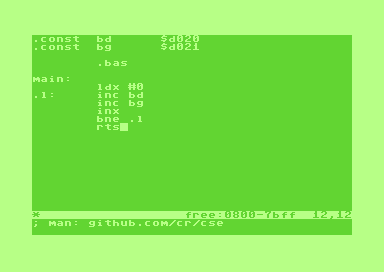 Commodore 64</td>
  <td align="center">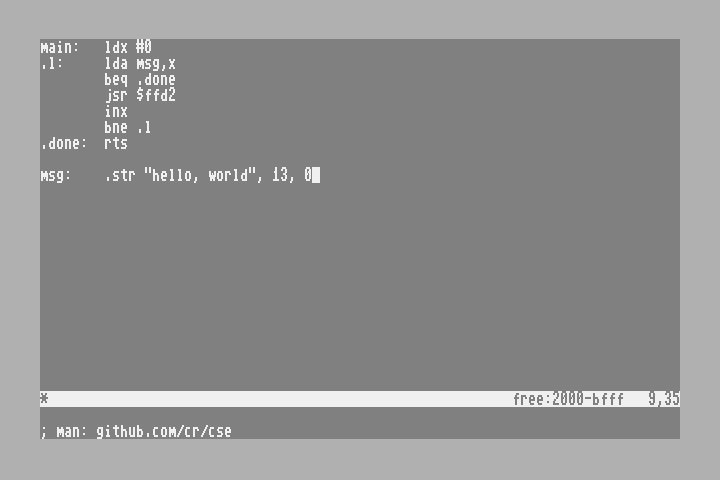 MEGA65</td>
</tr>
</table>

This page is the manual.  It is what `man: github.com/cr/cse` on
CSE's start screen points to.

## Who it's for

CSE is built for two kinds of programmer, and it refuses to compromise
on either.

**Experienced developers** who want a sketchpad.  An immediate-mode
6502 REPL with no toolchain, no build step, no context switch back to
the host OS.  The loop from "I want to try something" to "I am watching
it run" feels fluent without some pipeline in the middle.

**Learners** who want a computer that does one thing honestly.  RAM
you can read entirely, 56 well-documented CPU instructions to start
with, a memory map that fits a page, a screen that is literally the
command buffer.  No browser tabs, no notifications, no package
managers.  The scope is finite, the ceiling is visible, and the
computer hides no complexity.  Give them a 6502 book and this page,
and they're good to go.

The same design principles serve both — minimal footprint, maximum
workspace, fluent interaction, one environment instead of many tools —
because beginner and expert likewise benefit from a computer you can
understand completely.

For the longer story — why CSE exists, how it compares to its peers,
and what keeps the promise honest — see [background.md](background.md).

## The platforms

One CSE, built for each machine.  The commands, the editor, the
assembler's syntax and the debugger are the same everywhere; this is
where the builds differ:

| | Commodore 64 | MEGA65 |
|---|---|---|
| Runs | on a C64 or in VICE | in MEGA65 mode (not GO64), on a MEGA65 or in xemu |
| Screen | 40 × 25 | 80 × 25, 40 × 25 or 80 × 50 |
| CPU modes | 6502, and 6510 with the illegal opcodes | 6502, 4510, 45GS02 |
| Addresses | 16-bit | 16-bit, and flat 28-bit ones (`4.2000`) for every bank |
| Workspace | `$0800` up to your source text: 28 K, shared with the source | `$2000`–`$bfff`: 40 K, plus banks 1, 4 and 5 |
| Source text | in the same 64 K, below CSE | 32 K in a bank of its own |
| Source line | 39 columns | 79 columns |
| On-screen help | — | the HELP key |
| The editor's command key | C= | MEGA |
| Release files | `cse-c64.d64`, `cse-c64*.prg` | `cse-m65.d81`, `cse-m65.prg` |

Throughout this manual, a statement that names no platform holds on
all of them, and a difference names each platform.  The example
addresses (`$2000`, `$3000`) are in the workspace on every platform.

## Contents

- [Quick start](#quick-start) — [get it](#get-it), [start it](#start-it),
  [your first program](#your-first-program)
- [A look](#a-look) — screenshots and [themes](#themes)

The manual:

- [Concepts](#concepts)
- [REPL commands](#repl-commands)
- [Debugging](#debugging)
- [Files and disks](#files-and-disks)
- [Editor](#editor)
- [Assembler](#assembler)
- [Banks and flat addresses](#banks-and-flat-addresses) (MEGA65)
- [Memory](#memory) and [your program's rules](#your-programs-rules)
- [Error and warning messages](#error-and-warning-messages)
- [On the C64](#on-the-c64)
- [On the MEGA65](#on-the-mega65)
- [Development](#development)
- [License](#license)

## Quick start

### Get it

Grab the latest release from
[github.com/cr/cse/releases/latest](https://github.com/cr/cse/releases/latest).
Each release attaches a disk image and the bare programs for every
platform:

| Platform | File | What it is |
|----------|------|------------|
| C64 | `cse-c64.d64` | Disk image for VICE or a real 1541: `cse` (the 6510 build) and `cse-6502`, both compressed |
| C64 | `cse-c64.prg`, `cse-c64-exo.prg` | The 6510 build — the default; it knows the illegal opcodes too — raw and exomizer-compressed |
| C64 | `cse-c64-6502.prg`, `cse-c64-6502-exo.prg` | The 6502 build — legal opcodes only, a little smaller — raw and compressed |
| MEGA65 | `cse-m65.d81` | Disk image for the MEGA65's drive, its SD card or xemu: `cse` |
| MEGA65 | `cse-m65.prg` | The MEGA65 build |

Or [build from source](#development).

### Start it

| | Commodore 64 | MEGA65 |
|---|---|---|
| Put in the drive | `cse-c64.d64` | `cse-m65.d81` (from the SD card: `MOUNT "CSE-M65.D81"`) |
| Type | `LOAD "CSE",8,1` then `RUN` | `DLOAD "CSE"` then `RUN` |

CSE boots into the **REPL** and shows the memory that is yours.  Type
commands at the `AAAA:` prompt, in lowercase.

### Your first program

Press **RUN/STOP** to open the editor and type this in.  New lines
start indented; a label's `:` pulls its line to the left edge, and
SHIFT+SPACE (or TAB on the MEGA65) jumps to the next tab stop:

    main:   ldx #0
    .l:     lda msg,x
            beq .done
            jsr $ffd2
            inx
            bne .l
    .done:  rts

    msg:    .str "hello, world", 13, 0

Press **RUN/STOP** again to return to the REPL.  Type `a` to
assemble and `g` to run:

<table>
<tr><th>Commodore 64</th><th>MEGA65</th></tr>
<tr><td><pre>
0800:a
; asm...
; org  0800-081b    28b
; ok
0800:s "out" $081b
0800:g
hello, world
; rts
r pc:0800 a:00 x:0d y:00 s:ff nv-BdiZc
</pre></td><td><pre>
2000:a
; asm...
; org  0.2000-201b    28b
; ok
2000:s "out" $201b
2000:g
hello, world
; rts
r pc:2000 a:00 x:0d y:00 z:00 b:00 s:f1 nv-BdiZc ml:e000 mh:8300
</pre></td></tr>
</table>

The program went to the start of the workspace, because the source
has no `.org`.  Its output appears in the REPL; `; rts` says it
returned, and the `r` row shows the registers it left.

From here:

- `d` disassembles what you assembled; `m` shows it as bytes.  Both
  print rows you can edit on the screen: move the cursor up, change a
  byte or an instruction, press RETURN.
- `a`, then `t` steps through the program one instruction at a time
  (RETURN repeats the step); `b ADDR` sets a breakpoint, `g` runs to
  it, `c` continues.
- `s "hello"` saves the source to disk, `l "hello"` loads it back.
  The row `a` printed (`…:s "out" $…`) saves the assembled program:
  cursor up to it and press RETURN.
- `i` shows the memory map, `?` is a calculator (`? $2000+40`).
- A program that never returns: RUN/STOP+RESTORE breaks into it.
- `Q` (SHIFT+Q) leaves CSE.

On the MEGA65, the **HELP** key shows all commands, keys and
directives on one page.

## A look

<table>
<tr><th>Commodore 64</th><th>MEGA65</th></tr>
<tr>
  <td align="center"> Assemble, run</td>
  <td align="center">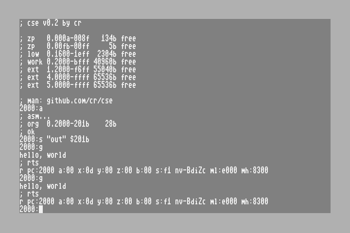 Assemble, run — and the memory that is yours</td>
</tr>
<tr>
  <td align="center">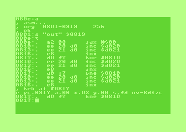 Stepping with <code>t</code>: the trace, the break, the registers</td>
  <td align="center">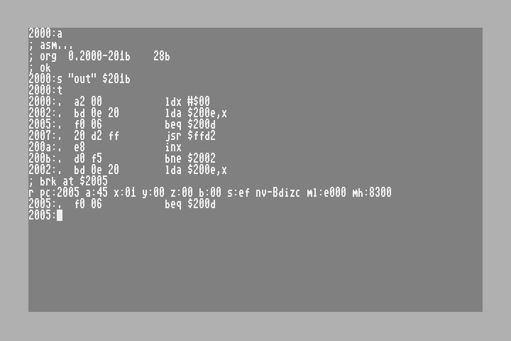 Stepping with <code>t</code>, with Z, B and the memory map in <code>r</code></td>
</tr>
<tr>
  <td align="center">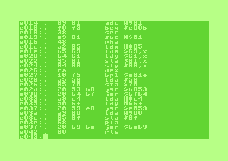 <code>d</code>: every row is a command you can edit</td>
  <td align="center">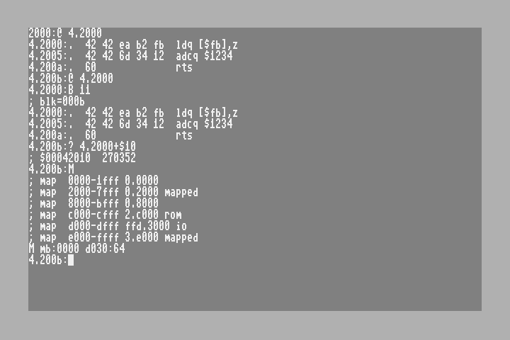 45GS02 code in bank 4, a 32-bit <code>?</code>, the map with <code>M</code></td>
</tr>
<tr>
  <td align="center"> <code>m</code>: dump and edit memory</td>
  <td align="center">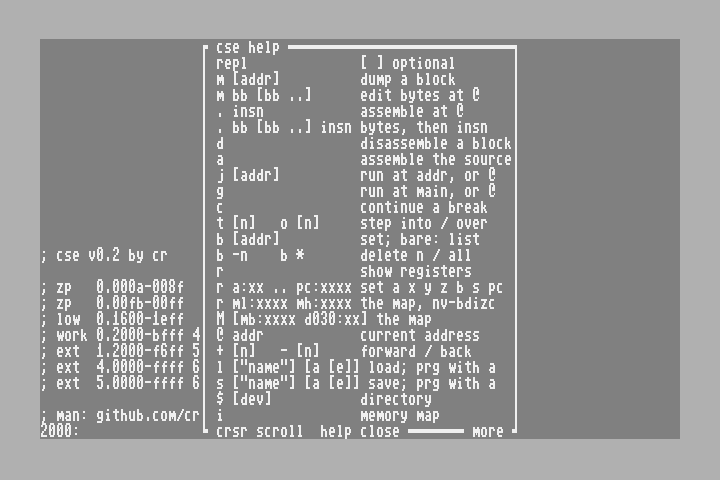 The HELP key's cheat sheet</td>
</tr>
</table>

### Themes

CSE ships with eighteen colour themes, chosen at build time — pick
one with `make THEME=NAME` — and the `C` command changes the colours
while it runs.  CLOUDY is the default on every platform; the pictures
are the C64's, the colours the same everywhere.

<table>
<tr>
  <td align="center">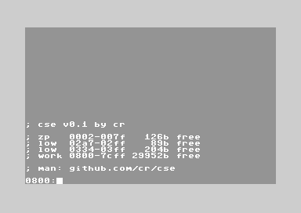 CLOUDY <i>(default)</i></td>
  <td align="center">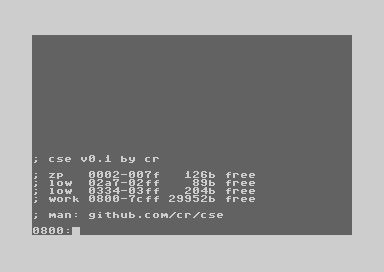 CONCRETE</td>
  <td align="center"> ASPHALT</td>
  <td align="center"> JIFFY</td>
</tr>
<tr>
  <td align="center"> GREENLAND</td>
  <td align="center">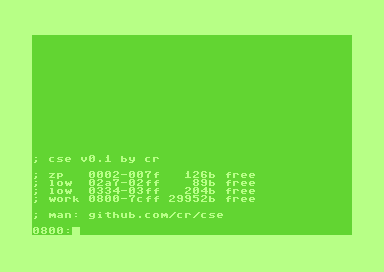 MOSS</td>
  <td align="center"> RADIOACTIVITY</td>
  <td align="center"> MATRIX</td>
</tr>
<tr>
  <td align="center"> HERCULES</td>
  <td align="center"> MILKYWAY</td>
  <td align="center">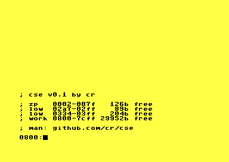 BRUCELEE</td>
  <td align="center"> LEEBRUCE</td>
</tr>
<tr>
  <td align="center"> MSPIGGY</td>
  <td align="center">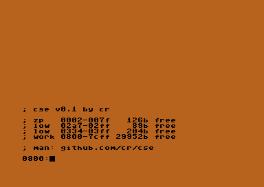 ORANGE</td>
  <td align="center">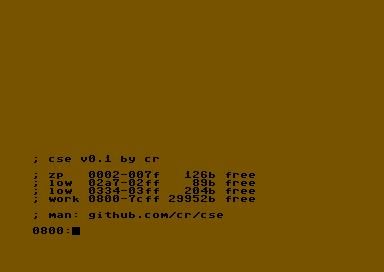 MUDDY</td>
  <td align="center">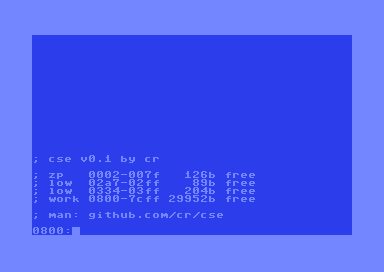 C64</td>
</tr>
<tr>
  <td align="center">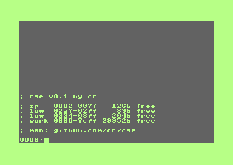 C128</td>
  <td align="center"> MEGA <i>(the MEGA65's own)</i></td>
  <td colspan="2" align="left" valign="top">Or specify any 3-digit hex code directly: <code>make THEME=cb5</code> (border, background, foreground — the C64 palette <code>0</code>–<code>f</code>, which the MEGA65 shares).  At runtime, <code>C bgf</code> (three adjacent hex digits, e.g. <code>C fc1</code>) sets all three.</td>
</tr>
</table>

## Concepts

CSE has two modes: the **REPL** and the **editor**.  Press RUN/STOP
to switch between them.

The **REPL** is a command prompt for inspecting memory, assembling,
running, and debugging code.  Every command operates on the
*current address* shown in the `AAAA:` prompt.  Navigate with `@`,
`+`, `-`.

The **editor** is a full-screen text editor for writing assembly
source.  The `a` command in the REPL assembles the editor's content
into memory.

**Type in lowercase.**  CSE runs in the lowercase character set:
commands, mnemonics, labels and hex digits are typed without SHIFT
(`lda $d020`).  SHIFTed letters are separate keys — `B`, `C`, `Q` and
`R` are commands of their own, and `M` on the MEGA65 — and hex digits
must be lowercase: `$d020` is a number, `$D020` typed with SHIFT is
an error.

### Your workspace

Your programs and data live in the **workspace**, from `workstart` to
`workend`:

| | Commodore 64 | MEGA65 |
|---|---|---|
| `workstart` | `$0800` | `$2000` |
| `workend` | the byte below your source text; it moves down as the source grows (`i` shows it) | `$bfff`, fixed |
| Beyond it | the source text, then CSE, up to `$cfff` | banks 1, 4 and 5 are yours too ([Banks](#banks-and-flat-addresses)); CSE and the source text live in banks 2 and 3 |

`workstart` and `workend` are built-in symbols: `.org workstart` in
a source, `@ workstart` or `? workend` in the REPL.  The assembler
refuses to write outside your memory (`;?N: range`), and breakpoints
must be inside it.  [Memory](#memory) has the whole map of each
machine.

### The edit-assemble-run cycle

1. Write source in the editor (RUN/STOP to enter).
2. Switch back to the REPL (RUN/STOP).
3. Set the origin: `.org $2000` in the source, or `@ $2000` in the
   REPL before assembling (or `.bas` in the source for a program
   that starts with `RUN`).  Without either, the code goes to the
   current address — `workstart` after start-up.
4. Assemble: `a`
5. Run: `g` (jumps to the `main:` label).
6. Inspect: `d` to disassemble, `m` to hex-dump, `r` for registers.
7. Debug: `b ADDR` to set a breakpoint on an instruction of your
   program, `g` to run, `t` or `o` to step, `c` to continue.

Repeat.  The source stays in the editor between runs.  Save the
source with `s "proj"` — it stores the source as a SEQ file with the
project name.  Save the assembled binary with the save line `a`
prints, or any PRG-mode form (e.g. `s "proj" $2000 $20ff`) — it is
stored as `proj.` (trailing dot), so source and binary never collide.

### Current address

The REPL prompt shows `AAAA:` — this is the *current address*.
It determines where `d`, `m`, `.`, `j`, `t` operate and is the
default origin for `a`.  Set it explicitly with `@ EXPR`, by typing
an `AAAA:` prefix in front of a command, or navigate with `+`/`-`.
`d`, `m` and `.` leave it after the bytes they showed.  After a
successful `a`, the current address moves to the `main:` label if
the source defines one; a break in your program moves it to the
break address.  On the MEGA65 the current address can also be a flat
one, in any bank: the prompt then reads `4.2000:`
([Banks](#banks-and-flat-addresses)).

### Block size

Commands like `d` (disassemble) and `m` (memory dump) operate on
a chunk of *block size* bytes.  Default is `$10` (16).  Change it
with `B EXPR`.  `+` and `-` also advance/retreat by the block size.

### Screen editing

`m` and `d` print rows that are themselves commands: an `m` row is
an `m` edit command, a `d` row a `.` command.  Move the cursor to
any row, edit the values directly on screen, and press RETURN to
execute the modified row.  This is the Commodore screen-editor
workflow: the screen *is* your input buffer.

For example, `d` might show:

    2000:.  a9 42     lda #$42
    2002:.  8d 20 d0  sta $d020
    2005:.  60        rts

Cursor up to the first row, change `42` to `07`, press RETURN — the
byte at `$2001` is now patched and the row reads `lda #$07`.
Changing the mnemonic or operand instead re-assembles the
instruction.  Pressing RETURN on an empty prompt repeats the last
`d`, `m`, `.`, `t` or `o` — `d` RETURN RETURN pages on through the
code.

A `d` row has room for the longest instruction: three bytes on the
C64, five on the MEGA65.  An `m` row shows 8 bytes in 40 columns and
16 in 80.

### Expressions

Anywhere CSE expects a number — command arguments, assembler
operands, directive values — you can use a full expression with
arithmetic, labels, and lo/hi byte operators.  Bare digits are
decimal; hex needs a `$`.  The syntax is under
[Assembler › Expressions](#expressions-1).

## REPL commands

A command is one character, optionally after an `AAAA:` address
prefix (four hex digits and a colon, which set the current address
first), followed by its arguments.  `;` starts a comment.  `EXPR`
and `ADDR` are expressions ([Expressions](#expressions)); `HH` is two
hex digits.

### Navigation

| Command | Syntax | Description |
|---------|--------|-------------|
| `@` | `@ EXPR` | Set current address |
| `+` | `+ [EXPR]` | Advance by EXPR (default: block size) |
| `-` | `- [EXPR]` | Retreat by EXPR (default: block size) |
| `B` | `B [EXPR]` | Show or set block size (default `$10`); `B` is SHIFT+B |

### Inspect and edit memory

| Command | Syntax | Description |
|---------|--------|-------------|
| `.` | `.` | Disassemble one instruction at current address |
| `.` | `. HH [HH] ...` | Poke hex bytes at current address: up to 3 on the C64, 5 on the MEGA65 |
| `.` | `. MNEM [OPERAND]` | Assemble one instruction at current address |
| `d` | `d` | Disassemble block-size bytes |
| `m` | `m [HHHH]` | Hex+character dump of block-size bytes, at `HHHH` (four hex digits) if given; on the MEGA65 any other address expression too (`m main`, `m 4.2000`) |
| `m` | `m HH [HH] ...` | Write bytes at current address: up to 8 on the C64, 16 on the MEGA65 |
| `i` | `i` | Show the memory map, the free regions highlighted |
| `?` | `? EXPR` | Calculator — shows hex and decimal; values below 256 also binary and signed |

**Your zero page.**  `m` and `.` on the zero page show what your
program sees there:

- C64: CSE keeps your `$00`–`$7f` apart from its own use of those
  bytes and swaps them in for every run; `m` and `.` show and edit
  your copy.
- MEGA65: CSE has a base page of its own and never touches yours;
  `m` and `.` show base page 0 as it is, and at `$00`/`$01` your
  program's CPU port.

### Assemble

| Command | Syntax | Description |
|---------|--------|-------------|
| `a` | `a` | Assemble the source in the editor; code before the first `.org` goes to the current address |
| `u` | `u [MODE]` | Show or set the CPU mode of the assembler and the disassembler ([CPU modes](#cpu-modes)) |

`a` prints one `; org AAAA-BBBB NNb` row per block of code (the
MEGA65 names the bank: `; org  0.2000-201b`), then `; ok` and a
ready-made save line (`AAAA:s "proj" $bbbb` — cursor up and RETURN
saves the binary), or `; N err` after the error rows.  After a
successful `a`, the current address moves to `main:` if the source
defines it, and `g` runs it.

### Run and debug

| Command | Syntax | Description |
|---------|--------|-------------|
| `j` | `j [ADDR]` | Run your code at ADDR (default: current address) |
| `g` | `g` | Run at label `main` (current address if there is no `main`) |
| `t` | `t [EXPR]` | Step into, EXPR instructions (default 1) |
| `o` | `o [EXPR]` | Step over — a `jsr` runs as one step (EXPR instructions, default 1) |
| `c` | `c` | Continue after a break |
| `b` | `b` | List breakpoints |
| `b` | `b ADDR` | Set breakpoint (8 slots; ADDR must be in your memory) |
| `b` | `b -N` | Delete breakpoint N (1–8) |
| `b` | `b *` | Clear all breakpoints |
| `r` | `r` | Show registers: PC, A, X, Y, SP, flags; on the MEGA65 also Z, B and the memory map |
| `r` | `r a:HH x:HH ...` | Set registers |
| `M` | `M [mb:HHHH d030:HH]` | MEGA65: list or set your program's memory map (SHIFT+M; [Banks](#banks-and-flat-addresses)) |

How a run, a break and a step behave: [Debugging](#debugging).

### Files

| Command | Syntax | Description |
|---------|--------|-------------|
| `l` | `l "proj"` / `l "proj" 0` / `l "proj" $2000` / `l "proj,p"` | Load source (SEQ) or binary (PRG); `0` uses the PRG's own load address |
| `s` | `s "proj"` / `s "proj" $end` / `s "proj" $start $end` | Save source (SEQ) or binary (PRG) |
| `$` | `$ [DEVICE]` | Directory listing; DEVICE (decimal 4–30) also becomes the current drive (default 8) |

The names and the address arguments: [Files and disks](#files-and-disks).

### Utility

| Command | Syntax | Description |
|---------|--------|-------------|
| `C` | `C [F \| GF \| BGF]` | Show or set colours: 1–3 adjacent hex digits (SHIFT+C) |
| `k` | `k` | Delete the source (asks `;!del src? y/n`) |
| `x` | `x` | Clear screen |
| `R` | `R` | Warmstart — redraws the screen and ends any debug session (asks `;!init? y/n`; SHIFT+R) |
| `Q` | `Q` | Quit CSE (asks `;!quit? y/n`; SHIFT+Q) |

`k`, `Q` and a source `l` first warn `;!unsaved` when the source has
unsaved edits.  Any key other than `y` cancels.

`Q` returns to BASIC on the C64.  On the MEGA65 it resets the
machine into BASIC 65, as at power-on: your program in bank 0
survives, the source text does not.

Colour values are hex digits `0`–`f`, the sixteen colours of the C64
on every platform, written together: `C 6` sets the text colour;
`C 06` background and text; `C 0e6` border, background and text.
`C` alone shows the current three (`; color: fc1`).

**Recovering the display.**  If your program has trashed the
screen, press SHIFT+CLR/HOME at the REPL prompt (ESC works too on
the MEGA65) to redraw the CSE display, or type `x` to clear it.  An
active debug session is kept.

### REPL keys

| Key | Action |
|-----|--------|
| RETURN | Execute the row the cursor is on |
| Cursor keys | Move anywhere on the screen (no wrap) |
| Printable keys | Type over the character at the cursor, up to the column before the last |
| DEL | Delete left; never deletes into an `AAAA:` prompt |
| INS | Open a space at the cursor |
| HOME | Cursor to column 0 |
| SHIFT+CLR/HOME | Redraw the CSE display |
| RUN/STOP | Switch to the editor |
| RUN/STOP+RESTORE | Break into running code; at the prompt, redraw |
| ESC (MEGA65) | Redraw the CSE display; then `4`, `5` or `8` switches to 40 × 25, 80 × 50 or 80 × 25 |
| HELP (MEGA65) | The cheat sheet, over the REPL or the editor; cursor keys scroll, HELP, ESC or RUN/STOP close |

## Debugging

Your program runs until it returns with `rts` (`; rts` and the
final registers), hits a breakpoint or a `brk` (`; brk at $PC`,
registers, and the next instruction), or you press
RUN/STOP+RESTORE (`; nmi at $PC`).  A break opens a **debug
session**: `t`, `o`, `c` and `r` work on the stopped program.

- `t` / `o` with no session show a **preview** (`; dbg at $PC`,
  registers, the instruction) of the code at the current address
  without running it; the next `t` / `o` / `c` starts it.
- Each step prints the instruction that ran, then the new break
  panel.  Pressing RETURN on an empty prompt takes another step, and
  the steps line up as a trace.
- `c` right after a breakpoint stop deletes that breakpoint, then
  continues — set it again with `b` to keep stopping there.  `c`
  steps over a `brk` you put in your code.
- A step whose next instruction lies outside your memory (a jump
  into ROM or into CSE) is refused with `;!range`; the session
  stays, `c` runs on.  Stepping into a `jsr` to the ROM (C64:
  `$e000`–`$ffff`; MEGA65: `$c000`–`$ffff`) steps over it instead.
- After the program has returned (`; rts`) the session is over:
  `c`, `t` and `o` answer `;?no ctx`; run it again with `j` or `g`.

**Registers.**  `r` fields go in any order and any subset: `a:HH`
`x:HH` `y:HH` `s:HH` `pc:HHHH` and the 8-character flags field
`nv-bdizc` (uppercase = set, lowercase or `-` = clear).  The MEGA65
adds `z:HH`, `b:HH` and the two halves of your program's memory map,
`ml:HHHH` and `mh:HHHH` — on one row in 80 columns, on a second row
in 40.  A bad field is `;?syntax` and changes nothing.  Edit a shown
`r` row on screen and press RETURN to set it.

**Breakpoints.**  Eight slots.  `b ADDR` must name an instruction in
your memory — the workspace, and on the MEGA65 also banks 1, 4 and 5
(`b 4.2005`).  Anything else is `;?range`.

**RUN/STOP+RESTORE** breaks into the debugger while your code is
running.  Pressed at the REPL prompt or in the editor, it redraws the
REPL screen (classic Commodore behaviour) and keeps any debug
session.

**Ending a debug session.**  `a`, `j` and `g` need a clean session;
while one is stopped at a break they ask first (`;!debug`, then
`;!asm? y/n` or `;!go? y/n`); `y` ends the session and runs the
command.  `R` (reset) asks `;!init? y/n` and ends any session.

**Printing from your program.**  The KERNAL's calls work: `jsr $ffd2`
prints at the REPL's cursor, `jsr $ffe4` reads a key.  A program's
output simply joins the REPL's — the quick start's `hello, world`.

## Files and disks

CSE is source-centric: a **project name** is a stem like `demo` that
stands for both the source and the binary.  Disk filenames are derived:
source is `demo` (SEQ), binary is `demo.` (trailing dot, PRG).  They
can't collide in the directory.

- Bare `l "demo"` / `s "demo"` loads/saves the **source**.
- Any address argument forces **PRG** mode: `s "demo" $2000` saves the
  binary as `demo.`; `l "demo" $2000` loads the binary to `$2000`,
  `l "demo" 0` loads at the PRG header address.
- Explicit `,s` or `,p` suffix bypasses derivation: `s "foo,p"` saves
  as literal `foo` PRG; `l "foo,s"` loads literal `foo` SEQ.
- Bare `s` or `l` (no string) reuses the last project name (default `out`).

PRG save addresses: one arg is end (start = current address); two
args are start and end.  **End is inclusive** — `s "proj" $2000 $3000`
saves bytes `$2000..$3000` inclusive, i.e. `$1001` bytes.  If end ≤
start, the arg is treated as a length.  End = 0 saves one block size.

After a source load or save CSE prints `; Nl Mb` (lines, bytes) and
warns `;!long LNN` for each line wider than the editor shows (39
columns on the C64, 79 on the MEGA65).  Loading source over unsaved
edits asks `;!load? y/n` first.

**Drives.**  `$` lists the current drive and shows its status; `$ 9`
switches to device 9 first.  On the C64 these are the IEC drives.  On
the MEGA65 units 8 and 9 are usually the internal drive or a mounted
D81, the others IEC drives.  A directory listing does not touch your
memory.

## Editor

Press RUN/STOP to enter the editor from the REPL and back.  The
editor uses the whole screen above its status bar; on the MEGA65
that is the current screen mode (switch modes at the REPL prompt).

| Key | Action |
|-----|--------|
| Printable | Insert a character; refused with a blip when the line is full (39 columns on the C64, 79 on the MEGA65) or the buffer is |
| RETURN | Newline with auto-indent (see below) |
| DEL | Delete left; at the start of a line, join it to the line above |
| INS | Insert a space at the cursor (the cursor stays) |
| Cursor keys | Navigate |
| HOME | Start of line |
| SHIFT+SPACE, or TAB on the MEGA65 | Tab: to the next tab stop, every 8 columns |
| C=+B / MEGA+B | Mark the cursor's line (again: unmark); the lines from the mark to the cursor are shown inverted |
| C=+X, C=+C / MEGA+X, MEGA+C | Cut / copy the lines from the mark to the cursor (or the cursor's line) |
| C=+V / MEGA+V | Paste the clipboard's lines above the cursor's line |
| C=+K, C=+J / MEGA+K, MEGA+J | Swap the cursor's line with the line above / below |
| RUN/STOP | Return to the REPL |

The command key is C= on the C64 and MEGA on the MEGA65 — the same
key in the same place.

**Smart indent.**  New lines start with a tab.  Typing `:` slides
the current line to column 0 — labels are recognised by the colon
and move to the left edge automatically.  A colon after a `;` (in a
comment) leaves the line where it is.  RETURN after a colon also
strips the gutter from the label line.

**Clipboard.**  Copy, cut and paste work on whole lines: the command
key with B marks a line, the cursor marks the other end, X or C
takes the lines in between (just the cursor's line without a mark),
V inserts them above the cursor's line — as often as you like.  The
clipboard needs no memory of its own: it sits right below the source
text and gives its space up when the source needs it.  On the C64
that space comes off the top of your workspace (`workend` moves down
while the clipboard holds lines); on the MEGA65 off the source
text's bank.

**Long lines.**  The editor never lets a line grow past its width.
A line that is already longer — loaded from a file written elsewhere
— shows `>` in the last column and cannot be extended.  The
assembler reads a line as far as the editor shows it and warns
`;!N: truncated` about the rest.

**The status bar** shows `*` when there are unsaved changes, the
project name, the free workspace (`free:0800-XXXX` on the C64, where
it shrinks as the source grows; `free:2000-bfff` on the MEGA65) and
the cursor's line and column.

## Assembler

### Source lines

    [label:]  [instruction | directive]  [; comment]

Blank lines and comment-only lines are ignored.  Case does not
matter.

### Labels

    main:           ; global
    .loop:          ; local (scoped to last global)
    main: lda #0    ; a label and an instruction on one line

A label ends with `:`.  A global label is a letter followed by
letters and digits; a local label is a dot followed by letters and
digits.  At most 23 characters (for a local, after the dot); no
underscore — the keyboard has none.  Refer to another global's local
as `main.loop`.  Put a global label before the first local one: a
reference to a local with no global above it is `;?N: exp val`.

The symbol table holds 256 symbols — labels and constants.

### Constants

    .const screen $0400
    .const cols   40
    .const border vic + $20

`.const name expr` defines a constant.  The name follows the
global-label rule; the value is required and is evaluated on the
spot, so it cannot use a label defined further down.

### Instructions and addressing modes

    lda #$42        ; immediate
    lda $42         ; zero page
    lda $42,x       ; zero page,x
    lda $1000       ; absolute
    lda $1000,x     ; absolute,x
    lda $1000,y     ; absolute,y
    lda ($42,x)     ; (indirect,x)
    lda ($42),y     ; (indirect),y
    jmp ($1000)     ; indirect
    rol             ; accumulator (bare form)
    rol a           ; accumulator (explicit form, equivalent)
    beq .loop       ; relative (the assembler computes the offset)

The 4510 and 45GS02 modes of the MEGA65 add:

    lda ($42),z     ; zero page indirect,z
    lda ($02,sp),y  ; stack-relative indirect,y
    phw #$1234      ; 16-bit immediate
    jmp ($1000,x)   ; absolute indirect,x
    bne faraway     ; branches reach any address: 8- or 16-bit offset, as needed
    rmb3 $12        ; the bit instructions carry their bit in the name
    lda [$42],z     ; 45GS02: through a 32-bit pointer
    ldq $1000       ; 45GS02: the quad register Q (A, X, Y, Z)
    adcq $10        ; 45GS02: quad forms are the mnemonic + q

An immediate operand must fit a byte (0–255, or −128…−1); use
`#<expr` / `#>expr` to take a byte of a larger value.

**`a` as an operand.**  `asl a`, `lsr a`, `rol a` and `ror a` (and
`inc a` / `dec a` in the 4510 modes) mean the accumulator.  With any
other mnemonic, `a` is an ordinary label.  If you define a label `a`
and write `asl a`, the accumulator wins and the assembler warns
`;!a shadow`.

### CPU modes

The CPU mode decides which mnemonics and addressing modes the
assembler accepts and how the disassembler reads memory.  `u` shows
and sets it in the REPL (`; cpu: 6502* 6510`, the active one
starred); `.cpu` sets it in a source, from its line on.

| Mode | Instructions | C64, 6510 build | C64, 6502 build | MEGA65 |
|------|--------------|:---:|:---:|:---:|
| `6502` | the 56 documented instructions | ✓ (at start) | ✓ | ✓ |
| `6510` | 6502 + the illegal opcodes | ✓ | | |
| `4510` | 6502 + the 4510's: the Z register, `bra`, `bsr`, `phx`/`ply`…, `trb`/`tsb`, `inw`/`dew`, `map`, the bit instructions | | | ✓ |
| `45gs02` | 4510 + the quad (`q`) and 32-bit pointer (`[ ]`) forms | | | ✓ (at start) |

A mnemonic of another mode of the build is `;?cpu`; one that no mode
of the build knows is `;?syntax`.  The debugger's steps follow the
real CPU whatever the mode says.

The illegal opcodes of the `6510` mode, with the usual aliases:
`aac` `aax` `ahx` `alr` `anc` `ane` `arr` `aso` `asr` `axa` `axs`
`cim` `dcm` `dcp` `dop` `hlt` `ign` `ins` `isb` `isc` `jam` `kil`
`lar` `las` `lax` `lse` `lxa` `rla` `rra` `sax` `say` `sbx` `sha`
`shs` `shx` `shy` `skb` `slo` `sre` `sxa` `sya` `tas` `top` `usb`
`xaa` `xas`.

The instructions the `4510` mode adds: `asr` `asw` `bbr0`–`bbr7`
`bbs0`–`bbs7` `bra` `bsr` `cle` `cpz` `dew` `dez` `eom` `inw` `inz`
`ldz` `map` `neg` `phw` `phx` `phy` `phz` `plx` `ply` `plz`
`rmb0`–`rmb7` `row` `rtn` `see` `smb0`–`smb7` `stz` `tab` `taz`
`tba` `trb` `tsb` `tsy` `tys` `tza`.  The `45gs02` mode adds the
quad instructions `adcq` `andq` `aslq` `asrq` `bitq` `cmpq` `deq`
`eorq` `inq` `ldq` `lsrq` `orq` `rolq` `rorq` `sbcq` `stq`.

### Directives

    .org $2000              ; set the program counter
    .const name expr        ; define a constant
    .cpu 6502               ; set the CPU mode
    .db $41, $42, "abc"     ; bytes; a string gives its characters
    .dw $1234, label        ; words (low byte first)
    .dd $12345678           ; 32-bit words (MEGA65)
    .str "hello", 0         ; PETSCII string, with trailing bytes
    .scr "hello"            ; screen codes, for writing to the screen
    .res 256, $ea           ; reserve 256 bytes, filled with $ea
    .align 256              ; pad with zeros to a multiple of 256
    .bas                    ; a BASIC line that starts your code
    .bas "title"            ; the same, with a REM

A directive's arguments end its line; only a comment may follow.

- **`.org`** sets where the following code goes.  Code before the
  first `.org` goes to the REPL's current address.  On the MEGA65
  `.org` also takes a flat address and assembles into that bank
  ([Banks](#banks-and-flat-addresses)).
- **`.db`** values must fit a byte, `.dw` values a word; a larger
  one is an error, never truncated.
- **`.str`** emits the characters as typed and does not end the
  string for you — add `, 0` if you want a terminator.
- **`.res`** and **`.align`** fill with `$00` unless `.res` names a
  fill byte.  Their sizes must be known where they stand: they
  cannot use a label defined further down (`;?N: fwd ref`).
- **`.bas`** moves the program counter to the start of BASIC —
  `$0801` on the C64, `$2001` on the MEGA65 — and emits a one-line
  BASIC program, `0 SYS <address>`, that calls the code after it.
  The saved PRG then starts with `RUN`.  `.bas "text"` appends
  `:REM text`.

Every byte the assembler emits must land in your memory; a line that
would write elsewhere reports `;?N: range` and writes nothing.

### Expressions

Anywhere a value is expected:

    lda #<screen            ; lo byte
    sta table+40            ; arithmetic
    ldx #cols-1             ; constant
    lda #mask & $0f         ; bitwise

Number formats: `$ff` hex (digits `0`–`9`, `a`–`f`, lowercase),
`42` decimal, `%10101010` binary, `*` the current program counter.

Operators (loosest to tightest):

    £ & ^                   ; OR (pound key) AND XOR (↑ key)
    + -                     ; add subtract
    * / << >>               ; multiply divide shift
    - ! < >                 ; negate NOT lo-byte hi-byte (unary)
    ( )                     ; grouping

**Zero page or absolute.**  `$xx` (1–2 hex digits) is a zero-page
value; `$0xx` and longer (3–4 digits) forces absolute, and stays
absolute through an expression.  A label defined further down is
always taken as absolute: define your zero-page constants above
their first use to get the short form.

**Values** are 16 bits on the C64.  On the MEGA65 they are 32 bits:
`$` takes up to 8 hex digits, and a flat address `4.2000` (bank,
dot, offset) is a number too.  Where 16 bits are needed — an
operand, a `.dw` — a larger value is refused, never cut;
`<(x>>16)` and `>(x>>16)` take its upper bytes.

### Forward references

A label defined later in the source can be used in instructions,
`.db` and `.dw`: the assembler reads the source twice.

    jmp end             ; fine — `end` is defined below
    .dw end
    end: rts

The exceptions are the values that decide sizes — `.res`, `.align`
and `.const` — which need their symbols defined above them.

### Example

    .cpu 6502
    .org $2000

    .const border $d020

    main:   ldx #0
    .loop:  stx border
            ldy #4
    .wait:  dey
            bne .wait
            inx
            bne .loop
            rts

Assemble and run:

    a               ; assemble (.org in the source sets the address)
    g               ; run (jumps to main:)

`a` answers with the block (`; org  2000-200d    14b`; the MEGA65
writes `0.2000-200d`), `; ok` and the save line
`2000:s "out" $200d`; `g` flashes the border and ends with `; rts`.
To watch the loop, set `b $2002` (the `stx`) before `g`, then step
with `t`.

## Banks and flat addresses

The MEGA65 has more memory than sixteen address bits reach, so its
CSE knows two kinds of address:

| Form | Kind | What it reaches |
|------|------|-----------------|
| `2000` | **CPU address** | what your program's CPU sees at that address, through its memory map |
| `4.2000` | **flat address** | physical memory: bank, dot, four hex digits — `4.2000`, `1.f6ff`, `800.0000` |

There is no mode to switch.  The current address carries its kind
and the prompt shows it (`2000:` or `4.2000:`); every row a command
prints carries the same form and re-executes in it.

- `@ 4.2000` makes the current address flat; `@ $2000` or a break
  make it a CPU address again.
- `m`, `.` and `d` at a flat address show and change the physical
  bytes; `+` and `-` run on into the next bank.
- `j 4.2000` starts code in a bank the way the KERNAL's `JSRFAR`
  does: `$2000`–`$7fff` of that bank mapped in, the KERNAL usable
  from the first instruction.  It works for `$2000`–`$7fff` of banks
  1, 4 and 5.
- `b 4.2005` sets a breakpoint on that byte, whatever maps it.
- `.org 4.2000` assembles into banks 1 (`1.2000`–`1.f6ff`), 4 and 5.
  Labels there have flat values; an instruction can use them within
  its own bank.  After `a`, `g` starts a `main` in a bank.
- `? 4.2000` answers `$00042000  270336`.
- CSE never writes into banks 2 and 3, which hold the ROMs, CSE and
  your source text: `;?range`.

`M` lists your program's memory map — a row for every stretch that
maps alike — and ends with a row you can edit and re-execute.  For a
program started with `j 4.2000`:

    ; map  0000-1fff 0.0000
    ; map  2000-7fff 4.2000 mapped
    ; map  8000-bfff 0.8000
    ; map  c000-cfff 2.c000 rom
    ; map  d000-dfff ffd.3000 io
    ; map  e000-ffff 3.e000 mapped
    M mb:0000 d030:64

A break keeps your program's map, CPU port and `$d030`, and a resume
puts them back, so you can debug code that maps memory itself.

On the C64 every address is a CPU address; there is nothing to
choose.

## Memory

At startup CSE shows the memory that is free for you; `i` shows the
whole map, your source text and CSE included.

### The C64's memory

    ; zp   0002-007f   126b free
    ; low  02a7-02ff    89b free
    ; low  0334-03ff   204b free
    ; work 0800-77ff 28672b free

| Region | Address | Use |
|--------|---------|-----|
| Your zero page | `$0002`–`$007f` | Your variables (CSE keeps its own apart) |
| Low page 2 | `$02a7`–`$02ff` | Free RAM (89 bytes) |
| Low page 3 | `$0334`–`$03ff` | Free RAM (204 bytes, the tape buffer included) |
| Screen | `$0400`–`$07ff` | The screen |
| Workspace | `$0800`–`workend` | Your programs and data |
| Source text | above `workend` | The editor's source |
| CSE | above the source, up to `$cfff` | CSE's code and data |
| I/O | `$d000`–`$dfff` | VIC-II, SID, CIA |
| KERNAL ROM | `$e000`–`$ffff` | and, in the RAM behind it, CSE's tables |

CSE banks the BASIC ROM out, so the workspace runs unbroken from
`$0800` up to the source text.

### The MEGA65's memory

    ; zp   0.000a-008f   134b free
    ; zp   0.00fb-00ff     5b free
    ; low  0.1600-1eff  2304b free
    ; work 0.2000-bfff 40960b free
    ; ext  1.2000-f6ff 55040b free
    ; ext  4.0000-ffff 65536b free
    ; ext  5.0000-ffff 65536b free

(In 80 × 50 the bank-4 row is missing: that screen lives there.)

| Region | Address | Use |
|--------|---------|-----|
| Your base page | `$0a`–`$8f`, `$fb`–`$ff` | Your variables (139 bytes) |
| KERNAL base page | `$02`–`$09`, `$90`–`$fa` | The KERNAL's |
| KERNAL and screen | `$0200`–`$15ff` | The KERNAL's variables; the screen in 40 and 80 × 25 |
| Low memory | `$1600`–`$1eff` | Free RAM (2304 bytes) |
| CSE's page | `$1f00`–`$1fff` | CSE's own base page and its way back from your program |
| Workspace | `$2000`–`$bfff` | Your programs and data |
| ROM, I/O, KERNAL | `$c000`–`$ffff` | As BASIC 65 maps them |
| Bank 1 | `1.2000`–`1.f6ff` | Yours (below it, the DOS buffers) |
| Banks 2, 3 | `2.0000`–`3.ffff` | The ROMs, CSE and your source text |
| Banks 4, 5 | `4.0000`–`5.ffff` | Yours |
| Attic RAM | `800.0000` and up | Yours |

CSE runs in MEGA65 mode and lives in the ROM banks, so bank 0 above
`$2000` is all yours.  BASIC 65 is not running while CSE is: the
memory it would use is free.

### Your program's rules

When you run code with `j`, `g`, `c`, `t`, or `o`, it runs on the
real machine, in the state a `RUN` would give it: text mode, the
KERNAL and its interrupt alive.  It may use the KERNAL (CHROUT,
GETIN, the disk calls) normally, and a final `rts` returns to CSE.

**It may freely use**

| Commodore 64 | MEGA65 |
|---|---|
| `$02`–`$7f` — yours across runs | `$0a`–`$8f` and `$fb`–`$ff` in the base page |
| `$02a7`–`$02ff`, `$0334`–`$03ff` (restore the tape buffer `$033c`–`$03fb` if you need tape) | `$1600`–`$1eff` |
| `$0800`–`workend`, the workspace | `$2000`–`$bfff`, the workspace |
| the I/O at `$d000` | bank 1 from `1.2000`, banks 4 and 5, the attic RAM, the I/O |

**It must leave alone**

| Commodore 64 | MEGA65 |
|---|---|
| `$80`–`$ff`, the KERNAL's zero page (`$fb`–`$fe` are free) | `$02`–`$09` and `$90`–`$fa`, the KERNAL's base page |
| `$0200`–`$02a6` and `$0300`–`$0333`, KERNAL state and vectors | `$0200`–`$15ff`, the KERNAL's pages |
| the source text and CSE, from `workend`+1 to `$cfff`, and the RAM under the KERNAL | CSE's page `$1f00`–`$1fff`, the DOS buffers `1.0000`–`1.1fff`, banks 2 and 3 |

**On every platform**

- **The stack** is yours to use normally; balance your pushes and
  pulls, and leave CSE 64 bytes below your stack pointer whenever a
  break can happen (`;!stk N` warns when there were fewer).
- **The break and NMI vectors** lead to CSE's debugger.  A program
  that replaces them gives up breakpoints, the clean return to CSE
  and RUN/STOP+RESTORE for as long as its own handlers are in.
- **The screen** is CSE's between runs: CSE restores its colours,
  character set and cursor on return, so a picture your program
  drew does not survive a break.  If your program cleared or
  repainted the screen, `x` clears it and SHIFT+CLR/HOME redraws it.

**On the MEGA65, a program that changes the memory map** keeps the
KERNAL at `$e000` and the first 8 K unmapped whenever interrupts are
on, keeps the 8-bit stack (`E` set), and calls the KERNAL only from
the map it was started in.  The simple ways to use other banks need
none of that: 32-bit pointers (`lda [$fb],z`) and DMA for data, the
KERNAL's `JSRFAR` for code.

## Error and warning messages

CSE uses a BASIC-style `;?<tag>` for errors and `;!<tag>` for
warnings and questions.  All tags are short and lowercase; the
leading `;` makes the row a comment, so RETURN on it does nothing.

### Errors (`;?`)

| Tag | Meaning |
|-----|---------|
| `;?syntax` | The command or instruction could not be parsed: unknown mnemonic or addressing mode, extra text after the arguments, a bad `r` field, a missing closing `"` |
| `;?cpu` | Mnemonic isn't valid for the current CPU mode (`lax` in mode `6502` on the C64's 6510 build, `taz` in mode `6502` on the MEGA65) |
| `;?expr <detail>` | Expression error.  `<detail>` is one of: `exp val` (expected a value), `ovfl` (overflow), `exp )` (missing parenthesis), `undef` (undefined symbol), `div0` (divide by zero); on the MEGA65 also `range` (a value too wide for the argument) |
| `;?bad val` | `b -N` with N not 1–8 |
| `;?range` | An address outside your memory (`b`), or a save of 0 bytes; on the MEGA65 also a write into banks 2–3 and a start in a bank outside `$2000`–`$7fff` of banks 1, 4 and 5 |
| `;?full` | All 8 breakpoints are in use |
| `;?cmd` | Unknown REPL command |
| `;?no ctx` | `c` with no program stopped at a break; `t` / `o` after the program has ended |
| `;?fail` | Disk I/O failed |
| `;?too big` | Source file too large for the free memory |

A command with an expression error does nothing else: `j nosuch`
runs nothing, `+ nosuch` moves nowhere.

### Warnings and questions (`;!`)

| Tag | Meaning |
|-----|---------|
| `;!unsaved` | The source has unsaved changes (before the `k`, `Q` and source-`l` questions) |
| `;!debug` | A debug session is stopped at a break (before the `a`, `j`, `g` questions) |
| `;!<action>? y/n` | Confirm `del src` (`k`), `quit` (`Q`), `init` (`R`), `load`, `asm`, `go`; `y` proceeds, any other key cancels |
| `;!range` | A step was refused: its next instruction is outside your memory |
| `;!stk N` | Your program's stack pointer was below `$40` at the break (`N` is its value, decimal): CSE needs 64 bytes of stack below it |
| `;!long LNN` | Source line `NN` is wider than the editor shows (after a load or save) |
| `;!a shadow` | A source line wrote `asl a` (or another accumulator form) while a label `a` is defined.  The accumulator wins. |

### Source-assembly messages

The assembler reports problems in the source as `;?N: <message>`,
where `N` is the line number (`;?42: undef` — undefined symbol on
line 42), and ends with `; N err` instead of `; ok`.

| Message | Cause |
|---------|-------|
| `bad insn` | Unknown mnemonic, addressing mode or directive |
| `cpu` | Mnemonic not valid for the CPU mode (same as REPL `;?cpu`) |
| `undef`, `ovfl`, `exp val`, `exp )`, `div0` | Expression error (as in the REPL's `;?expr`) |
| `bad val` | A directive's value is missing or unusable (`.const k` without a value, an unknown `.cpu` model, text after a directive's arguments) |
| `exp id` | A label or `.const` name is missing or breaks the name rules |
| `exp "` | A string without its opening or closing quote |
| `fwd ref` | `.res`, `.align` or `.const` uses a symbol defined further down |
| `too long` | Label longer than 23 characters, or an instruction too long after local labels are expanded |
| `sym full` | Symbol table full |
| `range` | The line would write outside your memory; nothing is written.  On the MEGA65 also an operand in another bank than its instruction |

`;!N: truncated` warns that line `N` is longer than the assembler
reads: 39 characters on the C64, 79 on the MEGA65.

## On the C64

- **Two builds.**  `cse` is the 6510 build: it starts in the `6502`
  mode, and `u 6510` (or `.cpu 6510`) adds the illegal opcodes.
  `cse-6502` knows the documented instructions only and is a little
  smaller.  Everything else is the same.
- **The screen** is the C64's 40 × 25.  A source line is 39 columns
  wide.
- **Memory.**  CSE, your source and your program share the 64 K: the
  source text grows downward from CSE, and the workspace is what is
  left below it.  `i` and the editor's status bar show how much.
- **The disk** holds the compressed programs; they unpack themselves
  when you `RUN` them.

## On the MEGA65

CSE runs natively in MEGA65 mode, not GO64.  The release's PRG,
`cse-m65.prg`, is the file on the disk image and starts the same way
from any disk.

- **Screen modes.**  80 × 25 by default; ESC 4 switches to 40 × 25,
  ESC 5 to 80 × 50, ESC 8 back to 80 × 25 — at the REPL prompt, not
  in the editor.  A switch clears the screen.  The editor uses the
  mode you entered it in, and a source line may be 79 columns wide
  in every mode; in 40 columns a longer line shows `>` at its edge.
- **HELP** opens the cheat sheet over the REPL or the editor: the
  commands, the keys, the directives and the expression syntax.
  The cursor keys scroll it; HELP, ESC or RUN/STOP close it.
- **Keys.**  TAB is the editor's tab (as SHIFT+SPACE).  MEGA is the
  editor's command key.  The function keys reach CSE raw: their
  BASIC macros are off while CSE reads keys, and a program you run
  finds them as you left them.  F9–F14 and the ALT combinations do
  nothing in CSE yet.
- **The CPU.**  The assembler and the disassembler speak the 45GS02
  by default, and the 4510 or the plain 6502 on request
  ([CPU modes](#cpu-modes)).
- **Banks.**  Flat addresses reach all memory, and code can be
  assembled into and started in banks 1, 4 and 5
  ([Banks and flat addresses](#banks-and-flat-addresses)).
- **Your program runs as `RUN` would start it**, in BASIC 65's
  memory map, and a break or a step keeps its own map.
- **Quitting.**  `Q` resets the MEGA65 into BASIC 65.  Your program
  in bank 0 survives the reset; the source text does not, so save it
  first (`Q` warns when it is unsaved).

## Development

    make                    # the C64 release: the PRGs + cse-c64.d64
    make PLATFORM=m65       # the MEGA65 release: cse-m65.prg + cse-m65.d81
    make bundle             # both, named as a release ships them, in build/bundle/
    make run                # build + launch in VICE
    make run PLATFORM=m65   # the MEGA65 build in xemu's xmega65
    make test               # run the test suite

All design documents, module specifications and project goals live
in [`doc/`](doc/README.md): the assembler's full grammar
([doc/assembler_syntax.md](doc/assembler_syntax.md)), the contract
between CSE and your program
([doc/userland_contract.md](doc/userland_contract.md)), the memory
maps ([doc/memory_design.md](doc/memory_design.md)), the build
([doc/build_system.md](doc/build_system.md)).  They go deeper than a
user needs; this manual does not depend on them.

### Build requirements

- [cc65](https://cc65.github.io/) -- provides `ca65` (assembler)
  and `ld65` (linker).  CSE is pure 6502 assembly; the cc65
  C compiler is not used.
- [exomizer](https://bitbucket.org/magli143/exomizer) -- PRG
  compressor used by the C64 release build.
- [VICE](https://vice-emu.sourceforge.io/) -- C64 emulator.
  Required for `make run`; also bundles `c1541`, which the
  release builds use to write the `.d64` and `.d81` disk images.
- Python 3 + [pipenv](https://pipenv.pypa.io/) -- pipenv manages
  the test virtualenv (py65, pytest).  `make
  tables` (auto-triggered by `make`) also runs Python.
- C64 KERNAL ROM for testing (copied from VICE; see `make test`).
- For the MEGA65 build: [xmega65](https://github.com/lgblgblgb/xemu)
  for `make run PLATFORM=m65`; the MEGA65 ROM, copied from xmega65 by
  `make m65-rom`; and, for its tests, the post-boot snapshots that
  `dev/capture_m65_state.py` records in xmega65
  ([doc/build_system.md § MEGA65 ROM](doc/build_system.md#mega65-rom)).

## License

CSE is released under the [MIT License](LICENSE).
© 2026 Christiane Ruetten (cr@23bit.net).
